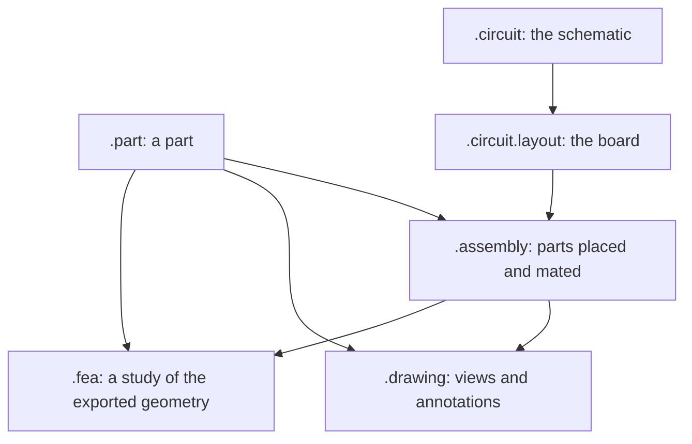

# The design language

RunMat stores every mechanical and electrical design as a text file. A part, an assembly, a drawing, a schematic and a board each have their own file kind, and all of them share one grammar: the same header, values, units, names, comments and statement forms. The editor, the agent and the command line read and write the same text, so a change made in any of them is a reviewable diff.

## File kinds

| File | Declares | Holds |
|---|---|---|
| `.part` | `part <name> { … }` | One part: inputs, sketches, a feature history, outputs, regions, published values, materials, configurations and PMI. |
| `.assembly` | `assembly <name> { … }` | Occurrences of parts and assemblies, connectors, mates, patterns, mirrors, fasteners, configurations and views. |
| `.drawing` | `drawing <name> { … }` | Sheet formats, sheets, views of a part or an assembly, annotations and tables. |
| `.circuit` | `circuit <name> { … }` | A schematic: sheets, ports, components, nets, buses, net classes, variants and simulation sections. |
| `.circuit.layout` | `layout <name> { … }` | The board for one circuit: outline, stackup, footprints, tracks, vias, pours, rules and fabrication settings. |
| `.fea` | studies | Simulation studies. The [FEA docs](/docs/simulation) describe them. |

The file kinds connect in one direction:



- An assembly places parts and other assemblies by name. A drawing shows a part or an assembly by name.
- A board reads its circuit: the components, nets and classes come from the `.circuit`, and the layout adds where they go.
- A study reads geometry exported from a part or an assembly (STEP), with the region names the design gives it.

## A first file

This part is a plate with three inputs. Every value carries its unit, and the feature names the sketch it extrudes.

```part
runmat 0.7
std 1

// A flat plate. Change the inputs to resize it.
part plate {
    input width : length = 80 mm
    input depth : length = 50 mm
    input thickness : length = 6 mm

    sketch outline on origin.xy {
        l1 = line(start = [0 mm, 0 mm], end = [input.width, 0 mm])
        l2 = line(start = [input.width, 0 mm], end = [input.width, input.depth])
        l3 = line(start = [input.width, input.depth], end = [0 mm, input.depth])
        l4 = line(start = [0 mm, input.depth], end = [0 mm, 0 mm])
    }
    feature body = extrude(profile = sketch.outline, distance = input.thickness)

    output plate = { body = feature.body.body, part_number = "PL-100" }
}
```

## The header

Every design file starts with two lines:

| Line | Meaning |
|---|---|
| `runmat 0.7` | The language version the file is written in. |
| `std 1` | The vocabulary version: the feature, mate, sketch and circuit words the file uses. A new word in a later vocabulary never changes the meaning of a file written against an earlier one. |

Comments start with `//` and run to the end of the line. Blank lines and indentation carry no meaning; the formatter writes four spaces per level.

## Statements

A file holds one declaration (`part`, `assembly`, `drawing`, `circuit` or `layout`) with a block of statements. Most statements have one of three shapes:

| Shape | Example | Used for |
|---|---|---|
| `<word> <name> = <value>` | `feature body = extrude(…)`, `net GND = { global = true }` | Named items: features, outputs, regions, mates, nets, components |
| `<word> <name> on <target> { … }` | `sketch outline on origin.xy { … }` | Blocks that hold their own statements: sketches, sheets, stackups |
| `<field> = <value>` | `part_number = "AX-100"`, `root = main` | Fields of the declaration itself |

These statement forms are shared by every design file kind:

| Form | Meaning | Page |
|---|---|---|
| `input <name> : <kind> = <default>` | A parameter that configurations, runs and sweeps may set. | [Values and units](/docs/design-language/values-and-units) |
| `let <name> = <value>` | A private named value. | [Values and units](/docs/design-language/values-and-units) |
| `use <kind> <name> [from <folder>] [as <alias>]` | Brings a design from another folder or package into scope. | [Folders, modules and use](/docs/design-language/modules) |
| `publish <name> = <value>` | A value, region or frame other files may read. | [Outputs, regions and published values](/docs/mcad/part/regions-and-publish) |
| `link <kind> <item> to "<target>"` | A traceable link to another file: `derived_from`, `verifies`, `supersedes`, `supplier_doc`. | [Outputs, regions and published values](/docs/mcad/part/regions-and-publish#links) |
| `constrain <relation>` | A sketch constraint. | [Sketches and constraints](/docs/mcad/part/sketches) |

## Values, names and references

Values are numbers with units (`80 mm`, `30 deg`, `10 kohm ± 1 %`), strings, words, lists `[…]` and records `{ key = value }`. A reference names an item by its kind and name: `input.width`, `sketch.outline`, `feature.body.face.end`, `net.GND`. The kind keyword in front keeps references unambiguous when two items share a name.

- [Values, units and expressions](/docs/design-language/values-and-units) lists the value forms and units.
- [Names and selectors](/docs/design-language/names-and-selectors) describes how references reach faces, edges, occurrences, pins and nets.
- [MATLAB functions in design values](/docs/design-language/matlab-functions) shows how a value can come from a `.m` function in the same folder.

## Folders are modules

A folder is the unit of scope. Every design in a folder can name every other design in it with no import: an assembly writes `use part bracket as left` for the `bracket` part anywhere in its folder. Designs in other folders and `+package` folders come in with `use … from`. See [Folders, modules and use](/docs/design-language/modules).

## Checking a design

The editor checks a file as you type. The agent and the command line run the same check:

```sh
runmat-design check board/flight_controller.circuit
```

Every problem has a severity, a code, the place it is written and, for a root cause, the features that failed because of it. See [Checks and diagnostics](/docs/design-language/checks-and-diagnostics).
