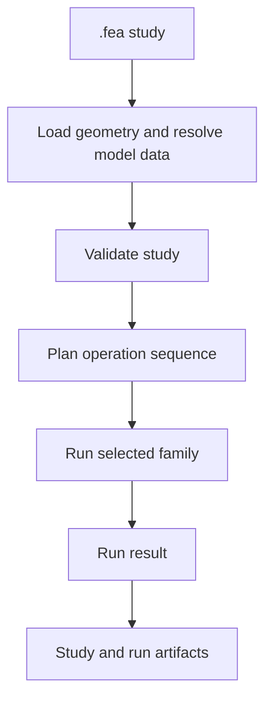
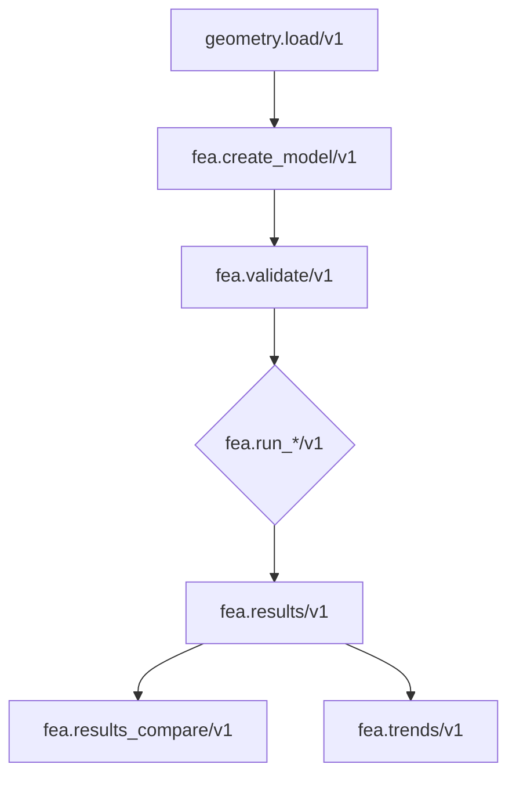

# Solves, Studies, and Sweeps

RunMat has three execution levels:

| Level | Use |
| --- | --- |
| Direct solve operation | A host already has an `AnalysisModel` and wants to call a specific run family. |
| Study | A named create-model, validate, plan, and run workflow. |
| Sweep | A deterministic sequence of studies. |

Most users should start with studies. Direct solve operations are best for host integrations that already own model construction.

## Study Flow



From the CLI:

```sh
runmat check studies/bracket_static.fea
runmat run studies/bracket_static.fea
```

From `.m` code:

```matlab
study = fea.load("studies/bracket_static.fea");
validation = fea.validate(study);
plan = fea.plan(study);
result = fea.run(study);
```

## What Check Does

`runmat check <file>` supports `.m` and `.fea`.

For `.fea`, it:

1. reads the YAML document,
2. resolves geometry paths,
3. builds or resolves the study model,
4. validates the study or sweep,
5. plans the operation sequence,
6. prints a validation and plan summary.

Use `runmat check --json <file>` for structured validation and plan data.

It does not solve.

## What Run Does

`runmat run <file>` supports `.m` and `.fea`.

For `.fea`, it executes either:

- `fea.run_study/v1` for a single study, or
- `fea.run_study_sweep/v1` for a sweep.

The result includes run ids, selected operation identities, quality gates, quality reasons, provenance, and artifact paths.

## Direct Solve Flow

Host integrations can call lower-level operations:



Direct solve operations require an `AnalysisModel`. They are the right boundary for applications that construct models themselves, manage trace ids, or need direct result queries.

## Study Operations

| Operation | Purpose |
| --- | --- |
| `fea.validate_study/v1` | Validate one study and write a validation artifact. |
| `fea.plan_study/v1` | Produce operation sequence, run operation/version, fingerprint, and plan artifact. |
| `fea.run_study/v1` | Execute one study and write run evidence. |
| `fea.validate_study_sweep/v1` | Validate a sweep with aggregate and per-study issues. |
| `fea.plan_study_sweep/v1` | Plan a sweep with per-study plan entries and failure entries. |
| `fea.run_study_sweep/v1` | Execute a sweep sequentially. |

## Run Options

Solver options are specified by an `execution` entry in `.fea`, or through typed runtime option
objects in host code. Each entry names a sequence step, backend, formulation requirement, and—when
needed—a matching `solver`/`options` pair. Validation checks the options against that step's typed
family and procedure.

Example:

```yaml
execution:
  - step: harmonic
    backend: cpu
    requirement: experimental
    solver: electromagnetic
    options:
      deterministic_mode: true
      precision_mode: fp64
      quality_policy: balanced
      residual_target: 1.0e-6
      harmonic_tolerance: 1.0e-7
      harmonic_max_iterations: 96
      sweep_enabled: true
      sweep_frequency_hz: [40.0, 60.0, 120.0]
```

Supplying options for a solver that does not support the referenced step is a validation error.

Structural transient solves use the average-acceleration Newmark method with a typed fixed-step
policy. The procedure step owns the physical start and end times; `time_step_policy` selects the
number of intervals over that authored domain. The structural transient kernel computes in `f64`,
and run provenance reports `fp64`; structural transient options therefore do not expose a precision
selector. Signal discontinuities and requested history samples become exact solve boundaries. A
boundary that lies on the nominal time lattice is snapped within a bounded floating-point envelope,
so it does not create a numerically meaningless extra increment.

Every accepted structural state retains displacement, velocity, and acceleration together with the
physical balance

```text
M a + C v + K u - f = r
```

The projected free-coordinate norm of `r` is the convergence residual. Its constrained-coordinate
components are the dynamic support reactions; translational and rotational reactions are published
separately when the formulation owns rotational degrees of freedom. The transient payload also
contains strain energy, kinetic energy, cumulative applied-load work, cumulative support work,
cumulative damping dissipation, the signed energy-balance residual, and its normalized absolute
error at every time point. For initial mechanical energy `E0`, the reported balance is
`E - E0 - Wload - Wsupport + D`. Formulation-owned solid
strain, stress, von Mises, and strain-energy-density histories are recovered from each accepted
physical state. Those fields remain absent for operator-only or other formulations that do not own
the corresponding continuum recovery.

The current direct-transient implementation requires invariant structural K, M, C, DOF layout, and
constraint operators during one run. A reassembly that changes any of them fails before advancing
the state. Time-varying loads and translational prescribed support motion are supported. Support
motion is an essential constraint, not an excitation: one real64 vector acceleration history plus
typed initial displacement and velocity determines displacement, velocity, and acceleration for a
selected global translational DOF. The history must use linear interpolation, reject extrapolation,
and cover the procedure interval exactly. RunMat integrates each acceleration segment exactly,
solves in absolute coordinates with a fixed affine reduction, and publishes absolute state. At a
jump, displacement and velocity remain continuous; the authored point-continuity rule selects the
public acceleration and reaction, while the right limit starts the next positive-duration interval.
Point refreshes add no work. Rotational support motion and displacement- or velocity-authored motion
are outside the current admitted envelope and fail closed.

## Results After A Run

Persisted run ids can be queried through:

| Operation | Purpose |
| --- | --- |
| `fea.results/v1` | Query fields, diagnostics, domain payloads, quality reasons, summaries, and provenance. |
| `fea.results_compare/v1` | Compare two persisted runs. |
| `fea.trends/v1` | Summarize recent runs by family. |

From RunMat code:

```matlab
run = fea.run(study);
results = fea.results(run);
stress = fea.field(results, fea.StructuralField.vonMises());
stress = fea.field(fea.results(run), fea.StructuralField.vonMises());
stressPage = stress.page(1, 1024);
figureHandle = plot(stress);
print(figureHandle, "von_mises.png", "-dpng");

meshHandle = mesh(fea.results(run));
print(meshHandle, "solver_mesh.png", "-dpng");

stepRun = run.step("static");
later = fea.results(stepRun.run_id);
comparison = fea.compare("run_baseline", "run_candidate");
trend = fea.trends("WindowSize", 16);
```

For interpretation, see [Results & Trust](/docs/fea/trust). For saved records, see [Evidence & Artifacts](/docs/fea/evidence).
