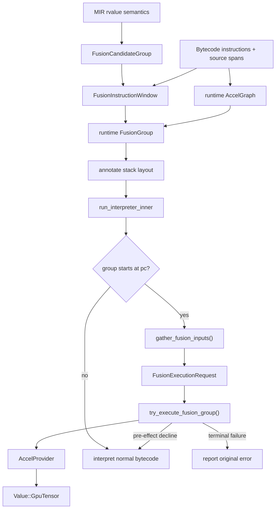
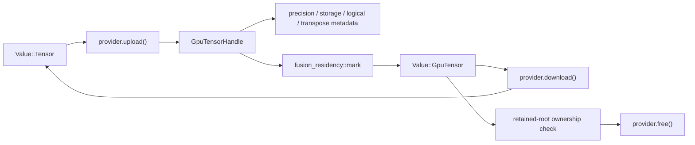

# Fusion Engine & Residency Management

The fusion engine identifies semantic regions that can run as a single accelerated unit. MIR analysis first marks fusion-capable statement runs, the bytecode compiler maps those semantic candidates onto VM instruction windows, and runtime planning reconciles those windows with a bytecode-derived `AccelGraph`. Once a plan is accepted, the interpreter can skip a span of ordinary bytecode and push a GPU-resident result instead.

This allows a single GPU kernel to perform multiple operations in a single dispatch, reducing the overhead of launching and synchronizing kernels.

Graph operations retain whether they came from operator syntax or a named call. Normalizing `A*B` to the matrix-product declaration does not turn it into a call to a scoped `mtimes` replacement. Named canonical calls carry the existing catalog binding identity; older serialized nodes remain named and unresolved, never inferred to be operators from their spelling. Runtime graphs are rebuilt from bytecode instructions, and explicit unknown serialized binding identities are rejected.

Every placed fusion family validates named bindings against the current runtime service before numerical probes or provider work. Replaced, absent, or ambiguous bindings retain ordinary dispatch. Object and other open-ended operands also retain runtime method dispatch. The request-local binding evidence participates in placement identity; it is not cached as permission for another invocation. Legacy declarations retain their unique physical-owner join only when no scoped service owns resolution. Shape, representation, and numerical-domain admission remain separate requirements after this binding check.

Residency management is the other half of the system. Once a value becomes `Value::GpuTensor`, the VM and provider need to know when that handle is still live, when it can be reused, and when it must be freed or gathered back to host memory.

## Fusion Pipeline

Fusion starts with MIR semantic candidates and ends with a `FusionExecutionRequest` passed to the active acceleration provider. The runtime executes by bytecode spans: MIR decides where fusion is allowed, while bytecode instruction windows and the `AccelGraph` provide the stack layout, values, and operations needed to run the fused group.

## Fusion Group Kinds

The VM maps semantic instruction windows into `FusionKind` variants, then runtime planning uses the `AccelGraph` to recover the graph nodes covered by those spans. Standalone graph-level detection still exists in `runmat-accelerate` for provider tests and pattern analysis, but normal VM execution is gated by MIR-derived fusion metadata.

| Kind | Purpose |
| --- | --- |
| `ElementwiseChain` | Chains of compatible elementwise operations over the same non-scalar shape. |
| `Reduction` | Single reduction operations or reduction-shaped execution windows. |
| `MatmulEpilogue` | Matrix multiplication followed by simple elementwise epilogue work. |
| `CenteredGram` | Recognized centered-product patterns; execution retains the original operations. |
| `ImageNormalize` | Image normalization chains with optional gain, bias, and gamma values. |
| `PowerStepNormalize` | Power iteration normalization pattern. |
| `ExplainedVariance` | Explained-variance computation pattern. |

Specialized patterns are detected before generic elementwise grouping so they are not swallowed by a broader chain.

`CenteredGram` recognition does not authorize a covariance substitution. The
runtime executes the original mean, subtraction, transpose, multiplication and
division, retaining their output classes, shapes and explicit GPU intent.

Matrix epilogues are checked in source order before uploads. The provider descriptor uses `MatmulAffine`: optional multiplication followed by `Add`, `Subtract`, or `SubtractFrom`. An absent phase performs no arithmetic, including no implicit `+0`. Provider implementations preserve this order rather than algebraically combine operations.

Clamp, power, and diagonal declarations apply only to the builtin implementations that declare them. Execution checks argument count, floating representation, source order, intermediate-value uses, and the selected builtin implementation. Fractional real powers require an established nonnegative base; integral powers use the same exceptional-value policy as standalone power. The WGPU diagonal route retains the full matrix and then runs diagonal extraction as a separate operation.

The request-local `ProviderWorkload.matmul` records data operand roles, dimensions, and exact scalar-control bits. Feasibility checks derive and verify the output shape. Cost estimates include retained product storage, diagonal warmup submission, uniforms, and data uploads. These are checked resource counts and static estimates, not measured execution times. Without an exact provider cache-readiness query, matrix preparation uses a cold-start estimate.

For WGPU elementwise fusion, preparation queries inspect the exact shader, binding layout, workgroup size, and required conversion pipelines without compiling or dispatching work. Cache contention leaves readiness unknown. A cold cache contributes an explicitly marked estimate; it is not a measured compilation time. Workgroup and matrix-tile dimensions come from the provider instance so shader generation, dispatch, and resource estimates use the same geometry.

## Runtime Gating

The interpreter only executes a fusion group when the current program counter matches the group's span start and the group is safe to replace. A group is skipped if the span contains VM barriers such as indexed assignment, member writes, or stack shapes that do not produce one live result.

When a group is accepted, the VM:

- Reads stack-layout metadata to determine the required stack operands.
- Resolves inputs from stack, globals, locals, constants, or graph node outputs.
- Creates a `FusionExecutionRequest`.
- Calls the appropriate fusion executor such as `execute_elementwise`, `execute_reduction`, or a specialized pattern executor.
- Pushes the returned `Value::GpuTensor` and advances `pc` past the fused span.

## Residency Model

GPU values are represented as `Value::GpuTensor(GpuTensorHandle)`. The handle carries shape, device ID, and buffer ID; additional metadata such as precision, storage kind, logical-ness, and transpose info is tracked by `runmat-accelerate-api`.

Residency cleanup accounts for GPU handles inside cells, structs, objects, handle objects, closures, and output lists. VM replacement and completion paths check retained roots before retiring discarded allocations. If a service cannot expose its retained values, cleanup remains conservative; an unavailable root view is not treated as empty.

## Auto-Promotion

Auto-promotion chooses when host tensors should become GPU tensors before or during built-in execution. Provider feasibility is normalized first. A shared local planner then compares complete CPU and provider candidates, including preparation, transfer, allocation, queueing, execution, synchronization, download, and downstream materialization costs. Calibrated thresholds, profile observations, existing residency, and fusion opportunities remain useful priors, but they no longer force a placement by themselves.

An unavailable cost is not treated as zero. When the selected runtime supports learning, bounded exploration can measure an otherwise eligible route. Measurements remain specific to that route: timing a numeric evaluator does not price execution through Runtime's original operations or a provider's asynchronous completion. Rejecting a provider candidate does not reject independently supported CPU implementations; explicit `gpuArray` intent still excludes host alternatives.

Residency accounting walks nested cells, structs, objects, object arrays, closures, handle objects, and output lists. Repeated GPU handles are counted once, cross-device handles require an explicit transition, and host or device mutation invalidates the stale copy. Small host-resident fusion groups can therefore fall back before upload or compilation, while a profitable resident chain remains on its provider.

When execution exposes more than one candidate region, placement evaluates the regions as one bounded graph instead of making unrelated per-operation choices. It distinguishes where a candidate executes from where its result will reside, accounts for transfer boundaries and simultaneously live intermediates, and admits work only within known host/provider memory, scratch, queue, cancellation, and scheduler-allocation limits. Unknown WebGPU total memory remains explicitly unknown rather than becoming a fabricated budget.

## Barriers and Fallbacks

Fusion groups rejected before provider effects—because of a barrier, stack mismatch, unsupported shape, unavailable device, exhausted planning budget or resource limit—execute as ordinary VM bytecode. A provider's certified pre-effect unsupported response can also take that route. Provider failures with unknown or completed effects remain execution errors; restoring the VM stack does not make provider work safe to replay. Automatic candidates stage their results and publish stack or workspace values only after successful execution. Sink operations can gather values when their language contract requires host materialization.

Provider feasibility is checked without executing a candidate. Unsupported operation identities, element types, storage/layout combinations, ranks, shapes, and resource requirements produce structured rejection codes. Placement diagnostics retain bounded, correlated events with stable reason tokens so these fallbacks can be inspected without recording source text or runtime values.

Each fusion attempt uses one correlation from the VM gate through input preparation, provider selection, shader generation when applicable, uploads, dispatch, kernel execution, synchronization when a real readback occurs, and completion or fallback. Timing remains stage-specific: synchronous host dispatch can report its measured duration, while providers that do not expose device or asynchronous queue timing emit an explicit unavailable reason instead of attributing the whole provider call to kernel execution. A feasibility rejection is recorded before shader generation, transfer, or dispatch, and ordinary bytecode remains the semantic fallback.

## Tuning

The acceleration layer exposes runtime knobs for calibration and backend tuning. The exact set is backend-dependent, but the important policy is stable: small or synchronization-heavy work remains on CPU; large or already-resident elementwise, reduction, matrix, image, and signal workloads are provider candidates when their complete risk-adjusted cost clears the placement margins.

From here, provider execution is covered in [wgpu Backend & Accelerate Provider](/docs/runtime/gpu/wgpu).
