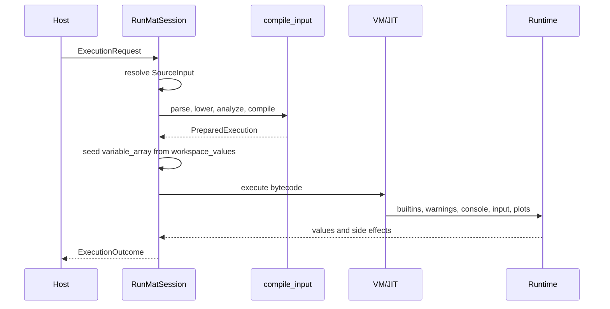

# Execution Requests

The primary session boundary is `RunMatSession::execute_request`. Hosts submit an `ExecutionRequest` and receive an `ExecutionOutcome`. This ABI is explicit enough for CLI output, browser payloads, notebook cells, editor integrations, and future remote execution to share the same execution contract.

## Request Shape

```rust
pub struct ExecutionRequest {
    pub source: SourceInput,                 // inline text or a path to read
    pub compatibility: CompatMode,           // parser/language mode for this request
    pub host_policy: HostExecutionPolicy,    // host-controlled execution policy
    pub requested_outputs: RequestedOutputCount,
    pub workspace: WorkspaceHandle,          // stable identity for binding keys
}
```

| Field | Role |
| --- | --- |
| `source` | Either `SourceInput::Text { name, text }` or `SourceInput::Path(path)`. Path sources are read before execution. |
| `compatibility` | Parser/language compatibility for this request, usually `runmat` mode. |
| `host_policy` | Host-controlled execution policy, currently including top-level await. |
| `requested_outputs` | Normalizes the returned flow for zero, one, or multiple requested outputs. |
| `workspace` | Stable `WorkspaceHandle` used to build interactive binding keys. |

`execute_request` temporarily applies request-specific compatibility, source identity, source name, host policy, and workspace handle. After the request finishes, the previous session defaults are restored.

## Compilation And Execution



`compile_input` always follows the normal compiler stack for submitted source: parser, HIR lowering, MIR lowering, MIR analysis, and VM bytecode compilation. The session contributes current workspace bindings, known semantic function names, project symbols, compatibility mode, and top-level await policy to lowering.

## Outcome Shape

```rust
pub struct ExecutionOutcome {
    pub flow: RuntimeFlow,                 // public result value
    pub workspace_delta: WorkspaceDelta,   // versioned upserts/removals
    pub display_events: Vec<DisplayEvent>,
    pub streams: Vec<ExecutionStreamEntry>,
    pub diagnostics: Vec<RuntimeDiagnostic>,
    pub effects: Vec<ObservedEffect>,
    pub suspension: Option<Suspension>,    // reserved for resumable work
    pub profiling: Option<ExecutionProfiling>,
    pub execution_time_ms: u64,
    pub used_jit: bool,
    pub figures_touched: Vec<u32>,
    pub stdin_events: Vec<StdinEvent>,
    pub fusion_plan: Option<FusionPlanSnapshot>,
    // ...
}
```

| Field | Role |
| --- | --- |
| `flow` | Public result value: `NoValue`, `Single`, output list, comma list, or dynamic list handle. |
| `workspace_delta` | Versioned upserts/removals for host workspace panes. |
| `display_events` | Values that should be displayed as execution output. |
| `streams` | Ordered stdout, stderr, and clear-screen entries captured during execution. |
| `diagnostics` | Runtime errors and warnings in a host-friendly shape. |
| `effects` | Structured side effects such as workspace clear or environment mutation. |
| `profiling` | Wall time and optional CPU/GPU profiling data. |
| `figures_touched` | Plot figure handles mutated by this request. |
| `stdin_events` | Recorded input/key events and errors. |
| `fusion_plan` | Optional fusion-plan metadata when enabled. |

The VM remains the semantic baseline. When the JIT is enabled, a session starts requests on the canonical VM path and may publish generic or guarded optimized native code after bounded heat. Eligible interactive native requests preserve the same display, `ans`, function-definition, and transactional workspace contracts. Unavailable or failed compilation leaves execution on the VM; after native entry, exceptions and cancellation do not replay the request through another executor.

## Requested Outputs

After execution, `apply_requested_output_policy` adjusts `RuntimeFlow`:

| Requested count | Behavior |
| --- | --- |
| zero | Public flow becomes `NoValue`. |
| one | Output/comma lists collapse to their first value when present. |
| exactly N | Single values become one-element output lists; longer lists are truncated to N. |

This keeps host callers from reverse-engineering MATLAB output arity from display output.


## Isolated browser program workers

Browser program workers load the same SDK and WASM asset revision as the parent.
The worker calls `workerProgramInventory()` to publish its own host inventory;
the parent must not substitute its UI realm's devices. A host advertising
`selectedProgramWork` supplies this inventory plus `launchProgram` and
`cancelProgram`.

Inside the physical worker, `createWorkerProgramInvocation(program)` admits the
exact Direct or Graph request and its scheduler assignment. The controller owns
one cancellation generation. `run()` returns the original program response and
a separate Runtime retirement receipt after workspace cleanup and local-task
drain. `cancel()` requires that same complete assignment, including its resource
leases. A rejected transport, foreign assignment, or unverified cleanup cannot
release the original grant or make the physical worker reusable. The caller may
observe cancellation before the worker's retirement terminal arrives.

This path reuses the existing VM selected-source execution, lifecycle host,
local-task supervisor, cancellation source, and scheduler Graph retirement
certificate. Owned numerical builtin work retains its existing distinct owned
work protocol. No frontend timer or `Worker.terminate()` manufactures retirement.

## Simulation execution choices before meshing

`planFeaSource` checks the saved study and returns host choices without creating a
solver mesh, assembling operators, or running the study. Existing preview extents
in physical metres and the requested element size can supply a coarse boxed-grid
workspace estimate. That estimate includes empty space in the bounding box and
cannot predict all refinement or solver fill-in; it is advisory, not an allocation
certificate. Missing geometry measurements remain unknown. A high rough estimate
can recommend desktop without blocking a browser attempt.

Only an explicit `runFeaSource` prepares the mesh. It rechecks the selected input
revision, uses the existing geometry/meshing owner and exact resource planner,
and checks current browser headroom before dispatching the numerical worker.
Selecting a host never changes the study's mesh settings to make it fit.

Browser timing observations use a distinct checked-source route including mesh
preparation, execution and publication. Old prepared-solve observations cannot
be reused as total-runtime estimates. Numeric parallel speedups are shown only
when both choices have applicable measured evidence; core count alone is not a
speedup estimate.


Browser result storage uses the same canonical artifact publisher and readers.
`storage::with_artifact_access` acquires a bounded, provider-captured transaction
when synchronous coherent scopes are unavailable. Artifact operations run against
its private view without awaiting or changing the process filesystem provider.
The original provider's conditional workspace publication controls visibility,
conflicts and recovery receipts. Failed operations discard the view; successful
results reach the caller only after publication is confirmed. Read operations
capture a fresh view, including after runtime reload. There is no second artifact
format or persistent result store. Browser field and scene APIs await this access.
The transaction inventory is bounded by the existing workspace publication limits;
resource admission failures remain explicit, rather than attempting unbounded
browser materialization. Native providers keep their existing coherent scopes.
