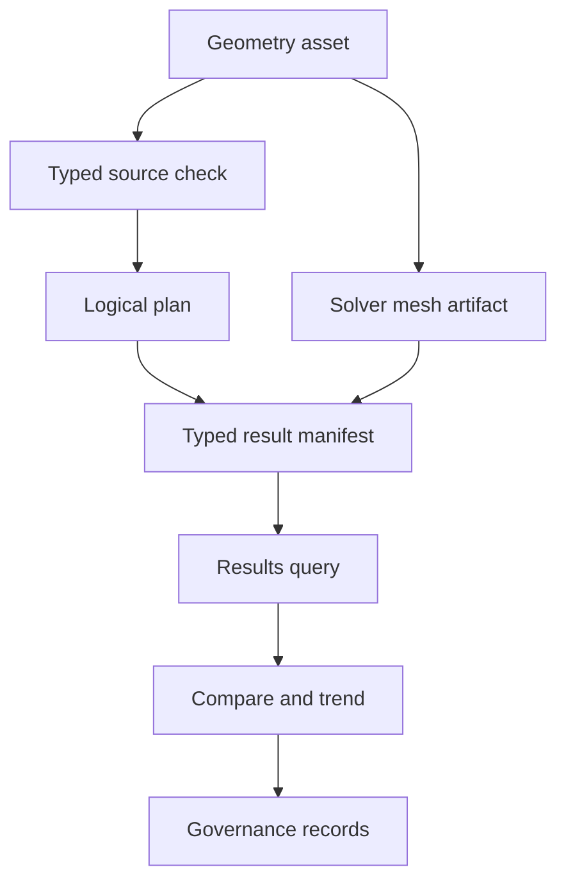

# Evidence and artifacts

FEA results need records. RunMat writes records at the boundaries where a workflow can fail, change behavior, or need review: geometry import, meshing, study validation, planning, solving, result queries, comparisons, and governance checks.

## Evidence Flow



## Record Types

| Record | Meaning |
| --- | --- |
| Operation envelope | The operation name, version, trace/request ids, and typed payload. |
| Operation error envelope | A typed failure with stable error code, severity, retryability, context, and operation identity. |
| Source diagnostic | A structured syntax, binding, type, unit, topology, availability, or contract diagnostic with source location. |
| Diagnostic | Domain-specific evidence emitted by a solver or runtime path. |
| Quality reason | Machine-readable reason a run was degraded or rejected. |
| Provenance | Backend, solver backend, precision, deterministic mode, solver method, preconditioner, and fallback events. |
| Artifact | Persisted JSON record used for review, replay, comparison, trends, or governance. |

## Study Evidence

`runmat fea check model.fea --json` is side-effect-free. It reports `valid`, `invalid`, or
`incomplete`, the root module identity, declared runnable roots, and structured compiler
diagnostics. It does not materialize geometry, produce a solver mesh, plan numerical workloads, or
write an evidence artifact.

`runmat fea plan model.fea --json` selects a study or sweep and reports its authored definition,
geometry, mesh, optional execution policy, case count, and canonical logical phases. It does not
execute those phases or claim realized model validation.

`runmat fea run model.fea --json` adds factual execution evidence and a content-addressed typed
result manifest. The manifest retains the checked/realized study, exact geometry and mesh identity,
meshing evidence, compiled model, resolved workloads, numerical receipts, semantic state, authored
output bindings, and published field references. Scheduler allocation, provider operations,
transfers, retries, timings, and terminal state remain measured run evidence.

The versioned `fea.validate_study/v1`, `fea.plan_study/v1`, and related sweep operations apply to
in-memory typed `fea.Study` and `fea.Sweep` objects. They are a separate host-object workflow and do
not replace typed `.fea` source checking.

## Issue Codes And Error Codes

Study issue codes use the `RM.FEA.STUDY.*` and `RM.FEA.STUDY_SWEEP.*` families.

Operation failures use `RM.<DOMAIN>.<OPERATION>.<REASON>`, for example:

- `RM.FEA.RUN_STUDY.INVALID_SPEC`,
- `RM.FEA.PLAN_STUDY_SWEEP.INVALID_SPEC`,
- `RM.FEA.RUN_PREP.STALE`,
- `RM.GEOMETRY.LOAD.UNSUPPORTED_FORMAT`.

Issue codes describe authoring problems found during validation. Operation error codes describe a failed operation boundary.

## Run Evidence

Every successful run stores an `AnalysisRunResult`. A successful operation can still produce a degraded or rejected result. The result carries:

- canonical physics-family, procedure, solution-space, and exact formulation-realization identity,
- `model_validity`,
- `solver_convergence`,
- `result_quality`,
- `run_status`,
- `publishable`,
- `quality_reasons`,
- diagnostics,
- provenance that distinguishes requested placement, actual execution, numerical backend, solver
  method, preconditioner, and typed fallback events,
- domain payloads where applicable.

Those fields explain what happened in the run. They do not, by themselves, prove that a physics family is validated for a given use.

## Artifact Roots

Configure FEA artifacts in `[runtime.fea]`:

```toml
[runtime.fea]
artifact_store = "filesystem"
artifact_root = "artifacts"
```

The default FEA artifact root is `./artifacts`. Run artifacts are stored under `runs`, study validation/plan/run evidence under `studies`, and thermo-field artifacts under `thermo-fields`. Meshing artifacts use the meshing artifact store described in [Meshing](/docs/simulation/meshing). The runtime uses the same filesystem provider for these paths that it uses for study and geometry input, so local, remote, sandboxed, and hosted filesystems follow the same path rules.

Use the artifact roots when a workflow needs reproducibility, auditability, trend analysis, or release governance.

## Results Access

Every successful procedure step stores a `run_id`. A single-step aggregate can be queried directly;
select a step explicitly when the study contains more than one:

```matlab
result = fea.run(study);
results = fea.results(result);

stepRun = result.step("static");
results = fea.results(stepRun);

% Later, or in another process that can see the same artifact root:
results = fea.results(stepRun.run_id);
stress = fea.field(results, fea.StructuralField.vonMises());
```

`fea.results(...)` can include or omit fields, field values, diagnostics, modal results, transient snapshots, and nonlinear results through Name/Value options (`IncludeFields`, `IncludeFieldValues`, `IncludeDiagnostics`, `DiagnosticCodes`, `IncludeModalResults`, `ModeIndices`, `IncludeTransientResults`, `TransientSnapshotIndices`, and `IncludeNonlinearResults`). `fea.compare(baselineRunId, candidateRunId)` compares two persisted runs. `fea.trends("WindowSize", 16)` summarizes recent persisted runs from the artifact store.

## Governance Inputs

Governance scripts consume benchmark reports, external-reference artifacts, threshold reports, promotion calibration records, thermo-field artifacts, and trend summaries.

Governance checks answer questions such as:

| Question | Records used |
| --- | --- |
| Did the operation contract stay stable? | Operation envelopes, typed errors, payload snapshots. |
| Did a benchmark stay within accepted thresholds? | Diagnostics, metrics, quality gates, quality reasons. |
| Is a family ready to promote? | Readiness reports, missing-evidence checks, trend posture, reference comparisons. |
| Did calibration drift? | Promotion calibration artifacts. |
| Can the run be explained later? | Study plan, run artifact, provenance, diagnostics, geometry and mesh artifacts. |

For the correctness standard behind those records, see [Verification & Validation](/docs/simulation/validation).
