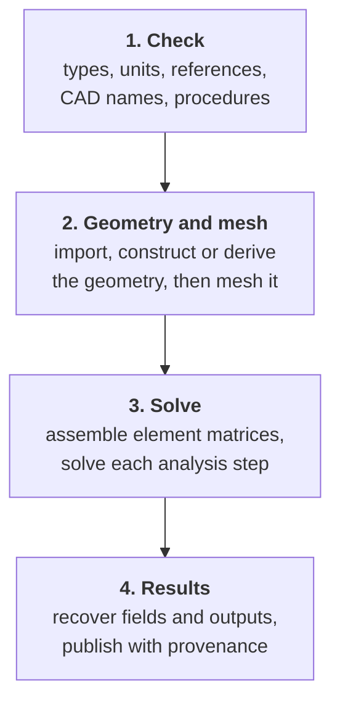

# Finite-element analysis

RunMat solves finite-element studies from CAD: stress and deflection in a bracket, the temperature of a heat sink, the natural frequencies of a frame, the current density in a bus bar, the sound field in a duct, the flow through a cold plate. A study is a plain-text `.fea` file that names the geometry, mesh, materials, loads, supports, analysis steps and results. RunMat checks the whole file in seconds, then imports the CAD, meshes, solves and publishes the results. RunMat Desktop, the `runmat` command line, the RunMat agent and `.m` code all work on the same files.

## What RunMat FEA does

**Physics families and analysis procedures.** The full matrix, with the status of each combination, is the [family and procedure matrix](./validation/status.md#families-and-procedures).

| Family | Procedures |
| --- | --- |
| Structural | static, modal, prestressed modal, linear buckling, transient, harmonic, prestressed harmonic, nonlinear (J2 plasticity, large deformation, contact); modal-superposition transient and harmonic, response spectrum, random vibration |
| Thermal | steady, transient; conduction, convection, radiation, heat sources |
| Electromagnetic | electrostatics, steady current, magnetostatics, time-harmonic eddy currents; transient [not yet in the current release](pending:electromagnetic.transient) |
| Acoustic | harmonic, modal, transient pressure acoustics |
| Fluid | steady and transient incompressible flow, Newtonian and generalized-Newtonian, porous media |
| Coupled | thermomechanical (thermal stress, thermal prestress), electrothermal (Joule heating), conjugate heat transfer, fluid–structure interaction |

**Geometry.** Import STEP, IGES and BREP files, with names, layers and AP242 parameters read from the CAD; construct parts from primitives and Boolean features; derive variants from CAD parameters; or generate geometry from `.m` functions. Regions are named in the CAD file and checked for the number of entities they match. See [geometry](./geometry.md).

**Meshing.** Linear (Tet4) and quadratic (Tet10) tetrahedra for solids, shell triangles for sheets, and beam lines for frames, with target size, surface deviation, grading and local refinement. Every mesh reports its quality. See [meshing](./meshing.md).

**Results.** Fields at nodes, elements and integration points; reductions such as the peak or mean over a region, flux through a face, and values at points; histories over time and frequency; and assessments that turn an output into a pass or fail verdict. See [outputs, fields and observations](./language/outputs-fields-and-observations.md).

**Studies at scale.** Parameter sweeps over named cases; all cores of a machine; GPUs, with a labeled fallback to the CPU reference path when no GPU is available; and clusters, with cases, frequencies and partitions fanned out across workers. See [running studies](./solves.md).

**Surfaces.** RunMat Desktop for editing and viewing results, the `runmat` CLI for scripts and CI, the RunMat agent for setting up and revising studies, and the `fea.*`, `geometry.*` and `meshing.*` functions for `.m` code.

## A complete study

This study clamps one end of a 1 m steel cantilever, applies a 1,000 N downward load to the other end and solves for displacement and stress on quadratic tetrahedra:

```fea source=cantilever-static.fea
geometry beam {
    file = "./geometry/cantilever.step"
    units = mm
    region body : solid { select name "Beam"; expect exactly_one }
    region fixed_end : face { select name "Fixed end"; expect exactly_one }
    region loaded_end : face { select name "Loaded end"; expect exactly_one }
}

mesh beam on geometry.beam {
    tetrahedra {
        order = quadratic
        target_size = 0.15 m
        maximum_deviation = 0.001 m
    }
}

material steel {
    mass_density = 7850 kg/m^3
    elastic {
        youngs_modulus = 200 GPa
        poisson_ratio = 0.3
    }
}

model loaded_beam {
    assign material.steel to geometry.beam.region.body
    constraint fixed_end {
        structural.fixed { target = geometry.beam.region.fixed_end }
    }
    load end_traction {
        traction on geometry.beam.region.loaded_end = [0, 0, -100000] Pa
    }
    load_case service { include load.end_traction }
}

study cantilever_static {
    geometry = geometry.beam
    mesh = mesh.beam
    model = model.loaded_beam
    analysis static { structural static {} }
    output displacement = analysis.static.field.node.displacement
    output von_mises = analysis.static.field.element.von_mises_stress
    output tip_deflection = max(magnitude(analysis.static.field.node.displacement), over = geometry.beam.region.loaded_end)
    assessment deflection_limit {
        value = output.tip_deflection
        maximum = 0.5 mm
        evidence = authored_samples
    }
}
```

Check it, inspect the plan, and run it:

```sh
runmat check cantilever-static.fea
runmat plan cantilever-static.fea
runmat login
runmat run cantilever-static.fea
```

<!-- fea:example:cantilever-static:displacement -->

The [linear static guide](./guides/linear-static.md) reads these results against a deflection limit and a stress allowable.

## How a study runs



Nothing is meshed or solved until the whole study checks clean. Every result is content-addressed: it records the source, CAD, mesh, solver settings and execution provider that produced it, so an unchanged geometry or mesh is reused rather than rebuilt.

## Where to go next

| To | Read |
| --- | --- |
| Run a first study in Desktop, the CLI or `.m` | [Get started](./get-started.md) |
| Learn what a finite-element result means | [What is finite element analysis?](./guides/what-is-finite-element-analysis.md) |
| Work through an engineering task | [Linear static](./guides/linear-static.md), [steady heat transfer](./guides/steady-heat-transfer.md), [modal analysis](./guides/modal-analysis.md), [mesh refinement](./guides/mesh-refinement.md) |
| Write or edit a `.fea` file | [The `.fea` language](./language/index.md) |
| Set up geometry, meshes, materials, loads and supports | [Geometry](./geometry.md), [meshing](./meshing.md), [models](./models.md), [loads](./loads/index.md), [constraints](./constraints/index.md) |
| See the equations each family solves | [Physics reference](./physics/index.md) |
| Run sweeps, on GPUs or on a cluster | [Running studies](./solves.md) |
| See how results are checked against references | [Validation](./validation/methodology.md) |
| See what is in this release | [Release status](./validation/status.md) |
